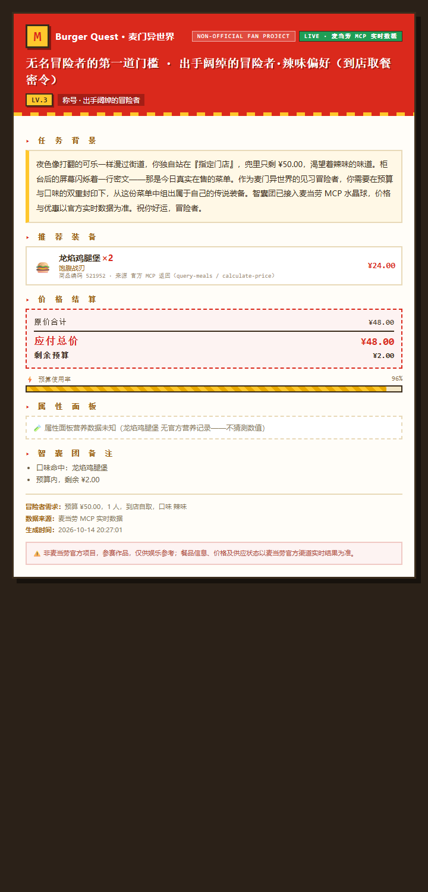
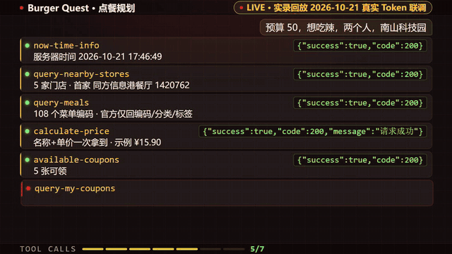

# 🍔 Burger Quest · 麦门异世界

[](https://github.com/yaohanbo1-hue/burger-quest/stargazers)
[](https://github.com/M-China/mcd-developer-innovation-challenge)
[](https://github.com/M-China/mcd-mcp-server)
[](#3-30-秒装上零部署)
[](https://opensource.org/licenses/MIT)

> 说一句人话（预算/口味/人数/用餐方式），RPG 游戏主持人调用**麦当劳中国官方 MCP Server 的真实菜单**，组出一份不超预算的点餐方案，并生成一张可以分享的任务成就卡。

**非麦当劳官方项目** —— 本项目为「麦当劳程序员创意开发大赛」参赛作品，由参赛者独立开发。餐品信息、价格及供应状态以麦当劳官方渠道的实时结果为准。

🎉 **1024 程序员节模式已激活（10-20 ~ 10-26）**：热量播报切换为程序员单位 **1G = 1024 kcal**，可领券 / 抽奖机会 / 临期积分一键巡检，限定卡片皮肤同步上线。



*↑ 2026-10-15 用官方 Token 的真实查询生成（LIVE 徽章）——所有餐品、价格、优惠均来自麦当劳 MCP 实时返回，不编造。*

📹 **60 秒快速了解**（MG 动画自动播放；完整版见 [burger_quest_mg.mp4](docs/media/burger_quest_mg.mp4)，含配乐与音效）：



⭐ **喜欢这个项目？点个 Star 就是给麦门冒险者的最大补给**（本赛事纯 Star 排名，每一颗都算数）。

---

## ⚡ 评委速览

**痛点**：「今天吃什么」每天都在发生，但预算、口味、营养、优惠券四个约束同时成立的最优解，人脑算不动——问通用 AI，它不知道麦当劳**此刻**卖什么、多少钱、你有哪张券。

**方案**：一个 WorkBuddy Skill。说一句话，它经 `mcd-mcp` 连接器直调官方 **26 个只读工具**——查门店、读菜单、`calculate-price` 权威算价、核验优惠券、汇总营养，给出最多 3 个可比较方案 + 一张可分享成就卡。**零部署：装上即用。**

```
一句话需求 → Skill 解析 → mcd-mcp 连接器 → 官方 26 个只读工具 → 权威核验 → ≤3 方案 + 成就卡
```

## 1. 这是什么

一个覆盖三类任务的麦门情报 Skill：

| 任务 | 内容 |
| --- | --- |
| **主线 · 点餐规划** | 预算/口味/人数/用餐方式（到店/外送麦乐送全链/得来速/堂食）→ 真实门店 → 真实菜单 → 权威算价 → ≤3 个可比较方案 |
| **支线 · 麦门情报网络** | 积分商城与抽奖（`catRuleIds=1>4` 实测 24 种兑换券）、生日派对档期侦查（279 城市→门店→日期→场次余位五链）、企业团餐促销、历史订单复盘 |
| **程序员节模式** | 10-20 ~ 10-26 激活：1G = 1024 kcal 热量播报、可领券/抽奖机会/临期积分巡检、限定卡片皮肤 |

**三条铁律**（写进 Skill 的每一节）：价格只认 `calculate-price` 权威返回，**绝不编造**；查不到就说查不到，**诚实的失败胜过好看的虚构**；一切写操作（下单/领券/兑换/预约）**一律不代做**，由用户本人在官方渠道完成。

## 2. 目标用户

- **选择困难症患者**：每天被「今天吃什么」折磨的人
- **精打细算型**：想在预算内吃好、把优惠券用对的人
- **麦门信徒**：把点餐当成一场冒险来玩的人

## 3. 30 秒装上（零部署）

不需要安装任何东西——只要两步：

**第一步：配置连接器**（一次性）

1. WorkBuddy → 左下角【连接器】→【自定义连接器】→【配置 MCP】；
2. 粘贴 [`mcp-config.example.json`](mcp-config.example.json) 的内容，把 Token 换成你自己的（到 <https://open.mcd.cn/mcp> 免费申请，手机号登录 → 控制台 → 激活）；
3. 启用 `mcd-mcp` 连接器。

> Token 只保存在连接器配置里；Skill **绝不会**在对话中索要 Token，也不会把它写进任何文件或输出。

**第二步：安装 Skill**

把本仓库的 [`SKILL.md`](SKILL.md) 安装为 WorkBuddy 技能（用户级技能目录或项目级均可），然后在对话框直接说：

> 「用麦门异世界帮我规划：预算 40，想吃辣，外送到南山科技园」

## 4. 它能做什么（示例输出）

```
用户：我们两个人想吃点好的，预算 100，堂食
AI：  🍔 庆典之王的加冕宴 · 出手阔绰的冒险者（堂食据点集结）
     【推荐装备】麦辣鸡腿堡套餐×2（¥64.00）· 麦乐鸡（5块）×2（¥23.00）· 可口可乐（大）×2（¥20.00）
     【价格结算】原价合计 ¥107.00 / 已核实优惠 -¥8.00 / 应付总价 ¥99.00（calculate-price 权威结果）/ 剩余预算 ¥1.00
     【智囊团备注】双主食够 2 人分食；优惠券经官方核验已生效；预算使用率 99%。
     【数据来源】query-meals / calculate-price / query-store-coupons / query-my-coupons（门店实时查询 · LIVE）
```

更多完整示例（预算受限诚实失败 / 低卡营养 / 地点模糊追问 / MCP 不可用 / 积分兑换 / 派对档期 / 程序员节模式）见 [SKILL.md §9](SKILL.md)。

### 成就卡（可选输出，按宿主自适应）

规划成功后可附一张分享卡：富文本宿主产出自包含 HTML 卡，纯文本 agent 产同内容 Markdown 卡；用户说「不用卡片」或规划失败时不出卡。卡内信息只能来自当次 MCP 返回，**不为卡片效果补任何数字**。

| 卡片 | 数据模式 | 文件 |
| --- | --- | --- |
| 真实实测卡 | LIVE · 真实 MCP 历史实测 | [live_real.png](examples/cards/live_real.png) |
| 两人分享卡 | DEMO · 离线演示数据 | [demo_share.png](examples/cards/demo_share.png) |
| 1024 限定皮肤 | DEMO + 程序员节彩蛋 | [festival_1024.png](examples/cards/festival_1024.png)（[HTML 源码](examples/cards/festival_1024.html)） |

### 价格从哪里来、什么时候无法确认（用户必读）

- 所有金额以 `calculate-price` 的官方返回为唯一权威（单位：分）；菜单价缺失的餐品**直接出局**，不用估算价冒充；
- 优惠券不默认可叠加——能否叠加以官方核验结果为准，预期与实际不符时如实备注；
- 连接器不可用/缺 Token 时**明确失败**，绝不用记忆里的菜单兜底；
- 未核验字段（总价未验、营养无记录）显示「未知」，不用装饰性数字填空；
- 分享出去的卡片不会自动刷新——金额、优惠与供应状态仅代表该次查询时的返回。

## 5. 真实集成证据

这个 Skill 不是「调通就行」的演示——26 个只读工具的**参数契约全部经过官方 Schema + 真实 Token 端到端实测**：

- **官方 Schema 快照**：2026-10-17 拉取官方 35 个工具的完整 `inputSchema`，verbatim 落盘 [`docs/official_tools_schema.json`](docs/official_tools_schema.json)；
- **端到端实测**：2026-10-13/14/19 三轮真实 Token 联调——派对五链（279 城市 → 40 门店 → 5 日期 → 场次价格/余位）、积分类目链 `1>4`（24 张兑换券）、团餐促销（`beType=6`）、历史订单空态与错误码（610303/610501/499）、券双字段契约（600010）均有记录；
- **2026-10-20 全服务复测**：连接 / 工具发现 / 门店 / 菜单 / 算价 / 券 / 营养 / 积分商城 / 派对链 / 团餐 / 活动日历共 14 项只读服务全部通过；
- 逐工具契约清单、调用链与踩坑记录见 [MCP_INTEGRATION.md](MCP_INTEGRATION.md)，选型与边界见 [MCP_TOOL_SELECTION.md](MCP_TOOL_SELECTION.md)；
- 开发过程与参考引擎记录见 [workbuddy.md](workbuddy.md)（开发期曾以 722 个自动化测试锁死同一套规则）。

## 6. 安全与边界

- **只读红线**：`create-order` / `cancel-order` / `auto-bind-coupons` / `draw-lottery` / `mall-create-order` / `party-order-create` / `delivery-create-address` 等一切写操作，即使用户要求也不调用；
- **隐私红线**：Token 不写文件不输出；`accountId`、配送地址、手机号不回显、不落盘；订单类数据只回答用户问到的字段；
- **Token 卫生**：只从连接器配置读取，绝不索要；
- **服务范围**：麦当劳 MCP 服务不含港澳台，用户提及时会说明；
- **医疗边界**：营养数据仅供参考，不构成医疗或减重建议。

## 7. 仓库结构（纯 Skill 交付）

```
burger-quest/
├── SKILL.md                   ← 本体：WorkBuddy Skill 入口（三类任务/调用链/红线/示例）
├── README.md                  本文件
├── CONTEST_DECLARATION.md     参赛声明（官方文件，内容未改动）
├── MCP_INTEGRATION.md         集成实测记录（工具/调用链/契约/踩坑）
├── MCP_TOOL_SELECTION.md      35 工具全量梳理与选型
├── workbuddy.md               WorkBuddy 开发上下文（专项奖励材料）
├── mcp-config.example.json    连接器配置模板（仅占位符）
├── docs/
│   ├── media/                 30 秒 MG 动画（MP4 + GIF 预览）
│   └── official_tools_schema.json   官方 35 工具 Schema 快照（verbatim）
└── examples/cards/            成就卡实例（LIVE 实测 / DEMO / 1024 限定，含 HTML 源码）
```

> 2026-10-21 起仓库转型为纯 Skill 交付：开发期的参考引擎（Python）与自动化测试不再随仓库分发，其实测结论已全部固化进 SKILL.md 与 MCP_INTEGRATION.md。

## 8. 参赛信息

- 大赛：麦当劳程序员创意开发大赛（<https://github.com/M-China/mcd-developer-innovation-challenge>）
- 参赛申请：<https://github.com/M-China/mcd-mcp-server/issues/32>
- 开发工具：WorkBuddy（开发对话存档见 [workbuddy.md](workbuddy.md)）
- 排名规则：**纯 GitHub Star 排名**，前 100 名上榜；报名截止 2026-10-25 23:59（北京时间），排名截止 10-26 00:00

## ❓ 评委常见疑问（FAQ）

**Q1：真的调用了麦当劳官方 MCP 吗，会不会是写死的假数据？**
真实模式经 `mcd-mcp` 连接器直连 `https://mcp.mcd.cn`（官方 Streamable HTTP）。2026-10-13/14/19/20 四轮真实 Token 联调实测，还原过 401/429、券双字段契约 600010、算价分单位、派对五链全通。首屏那张卡就是 10-15 的真实查询输出。离线演示数据一律带 DEMO 徽章，与实时结果明确区分。

**Q2：价格会不会被编造？**
不会，这是最硬的约束：总价只来自 `calculate-price` 权威返回；菜单价缺失的餐品直接出局；估算只用于预筛且只低估、绝不高估；优惠券不默认可叠加。每次任务的数字来源可在输出的「数据来源」中逐项追溯。

**Q3：和直接问 ChatGPT / 通用 AI 有什么区别？**
通用 AI 不知道麦当劳**此刻**卖什么、多少钱、你有哪张券。本 Skill 的餐品、价格、优惠券、营养全部来自官方 MCP 实时返回，且带完整审计链路；同时把「选择困难」包装成 RPG 任务，输出可直接执行、可分享。

**Q4：MCP 用在了哪些环节，调用量会不会很大？**
一次任务按需调用 26 个只读工具中的若干个（并非每次全调）：门店查询 → 菜单骨架 → 价格发现（一次算价同时拿名称+单价）→ 优惠券/营养 → 组合验价。开发期经过去重 + 短 TTL 缓存 + 分工具超时优化，单任务约 7-15 次调用，远低于官方 600 次/分钟的限流。

**Q5：为什么不能下单？**
刻意只读：涉及真实资金/库存的工具一律不接（Skill §8 红线）。生成方案供用户确认，比「一键下单」更适合参赛演示的边界，也符合比赛规则对「具有实际影响的操作必须等待用户明确确认」的要求。

**Q6：没有 MCP Token 能体验吗？**
连接器未配置时，Skill 会明确提示去 WorkBuddy【连接器】启用 `mcd-mcp` 并给出 Token 申请地址——明确失败，不静默切换演示数据。演示数据仅在用户明确知晓并同意的场景下使用，且全程标注 DEMO。

**Q7：为什么仓库里没有引擎代码了？**
2026-10-21 转型为纯 Skill 交付：本仓库只保留 Skill 本体与证据文档。开发期的参考引擎（Python 实现，含 722 个自动化测试、覆盖率 89.97%、mypy/bandit/pip-audit 全绿）已完成使命——它的全部实测结论固化在 SKILL.md 与 MCP_INTEGRATION.md 中，开发过程记录在 workbuddy.md。
