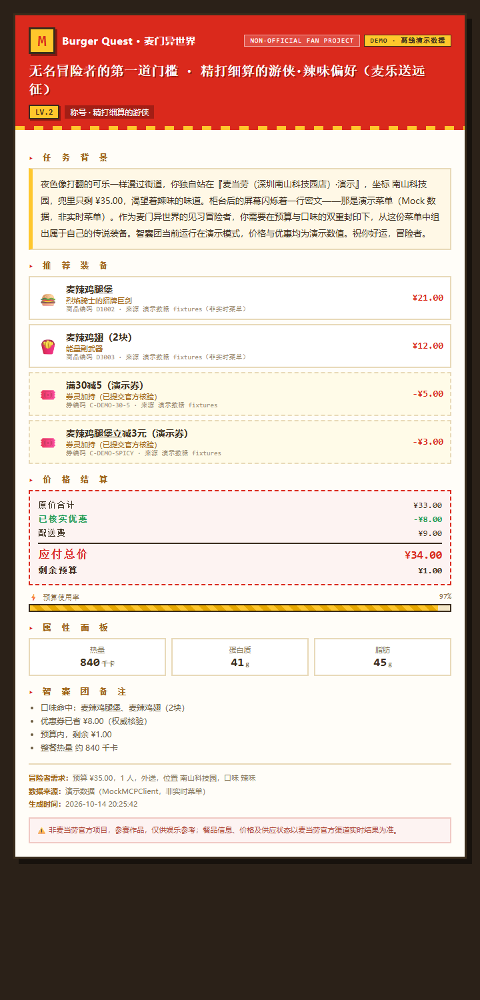
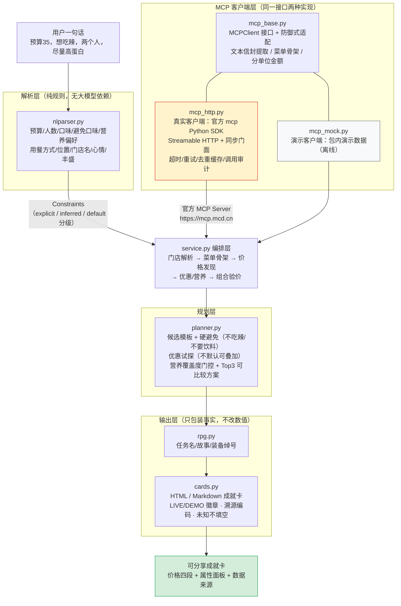
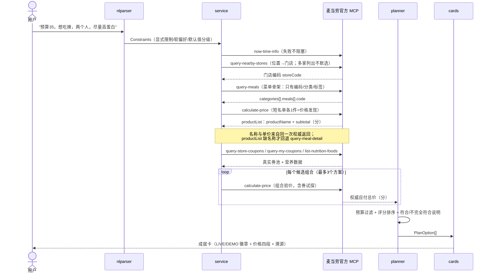

# 🍔 Burger Quest · 麦门异世界

[](https://github.com/yaohanbo1-hue/burger-quest/actions/workflows/ci.yml)
[](https://github.com/yaohanbo1-hue/burger-quest)
[](https://opensource.org/licenses/MIT)
[](#6-测试)
[](#6-测试)
[](#6-测试)
[](#6-测试)

> 输入预算、心情、口味和用餐偏好，RPG 游戏主持人替你从**麦当劳中国官方 MCP Server 的真实菜单**里，组出一份不超预算的点餐方案，并生成一张可以分享的任务成就卡。

**非麦当劳官方项目** —— 本项目为「麦当劳程序员创意开发大赛」参赛作品，由参赛者独立开发。餐品信息、价格及供应状态以麦当劳官方渠道的实时结果为准。

---

## ⚡ 评委速览

**痛点**：「今天吃什么」每天都在发生，但预算、口味、营养、优惠券四个约束同时成立的最优解，人脑算不动——问通用 AI，它不知道麦当劳**此刻**卖什么、多少钱、你有哪张券。

**方案**：把点餐变成一场 RPG 冒险。说一句话（预算/口味/人数/用餐方式），游戏主持人调用**麦当劳中国官方 MCP Server** 拉取真实菜单与权威价格，给出最多 3 个可比较方案 + 一张可分享成就卡。

```
一句话需求 → nlparser 解析 → 官方 MCP（10 个在用只读工具）→ planner（≤3 方案，权威核验）→ 成就卡
```

**技术亮点**：

- **官方 MCP 全链路**：10 个在用只读工具（7 个常规主链路 + 1 个餐品详情回退 + 2 个第一阶段扩展：活动日历/可领券；代码 `TOOLS_USED` 注册表为权威，并非每次任务全调）走官方 Streamable HTTP + 官方 `mcp` SDK；分工具超时、有限退避、429 降速、401 不重试、连续失败断路（重试/熔断细节有专项测试）；
- **不编造铁律**：总价只认 `calculate-price` 权威返回；菜单价缺失的餐品直接出局；缺 Token 明确失败（退出码 2），**绝不回退演示数据**；
- **工程完成度**：657 个测试、覆盖率 91.44%、mypy 0 error、bandit 0 finding、pip-audit 0 漏洞——四道质量门禁（覆盖率 ≥85% / mypy 零 error / bandit 零 finding / pip-audit 零漏洞）；**当前最新提交的 CI 通过 7/7 个 job**：Linux ×4（Python 3.10/3.11/3.12/3.13：全量测试 + 覆盖率门禁 + wheel 打包自检 + 空白检查）、Quality gates ×1（密钥扫描 / skill 文档一致性 / mypy / bandit / pip-audit / 离线演示可复现性）、Windows ×2（Python 3.11/3.12：全量测试 + PowerShell 脚本解析 + 无 Token 路径行为 + CLI 入口与离线演示）；
- **安全边界**：本地 Web 界面 Host 白名单 + Origin 同源校验（挡 DNS rebinding 与跨站代打，`Origin: null` 一律拒绝）；Token 不落审计/日志/卡片/进度存档任何一处。

**60 秒验证**（完全离线，无需 Token）：

```bash
pip install .
python -m burger_quest demo "我想吃辣，预算35，外送到南山科技园，一个人"   # 完整任务 + 成就卡
python -m burger_quest demo "预算5块，想吃汉堡"                           # 诚实的失败，不是编造
python -m pytest tests/ -q                                              # 657 个测试
```

深读：MCP 集成与联调实测 → [MCP_INTEGRATION.md](MCP_INTEGRATION.md)；架构与数据流 → §8；质量门禁 → §6。

---

## 1. 项目介绍

「麦门异世界」是一个游戏化点餐规划 Skill：把「今天吃什么」变成一场 RPG 冒险。

- 你（冒险者）说出预算、口味、心情、人数、用餐方式；
- AI（游戏主持人）调用麦当劳中国官方 MCP Server 查询**真实可售菜单、真实价格、真实优惠券和营养数据**；
- 主持人生成任务书：任务名称、故事背景、推荐装备（真实餐品）、选择理由、总价与剩余预算；
- 一键生成分享成就卡（HTML / Markdown）。



<sub>↑ 实际运行生成的成就卡（DEMO 数据；真实 MCP 模式带 `LIVE` 徽章）。[查看 HTML](examples/cards/demo_spicy.html) · [Markdown](examples/cards/demo_spicy.md) · [更多卡片](examples/cards/)</sub>

### 三条铁律（贯穿全部代码与测试）

1. **不编造餐品**：进入方案的每一项都来自 `query-meals` 返回的真实菜单；
2. **不编造价格**：总价只来自 `calculate-price` 的权威返回，菜单价缺失的餐品直接出局；
3. **不编造优惠与库存**：优惠券必须来自 `query-store-coupons` / `query-my-coupons`，库存状态以 MCP 返回为准。

MVP **只生成方案，不自动下单**；`create-order` 等具有实际影响的操作需要用户明确确认后才可调用（本仓库未接入）。

## 2. 目标用户

- 选择困难症患者：一句话需求 → 直接可执行的点餐方案；
- 预算敏感用户：预算内多组合对比，剩余预算一目了然；
- 关注营养的用户：低卡 / 高蛋白偏好筛选，热量与蛋白质来自 `list-nutrition-foods` 真实数据；
- 任何想在 AI 对话里「玩着点餐」的开发者和玩家。

## 3. 安装

```bash
# 要求 Python >= 3.10
git clone https://github.com/yaohanbo1-hue/burger-quest.git
cd burger-quest

# 开发/测试（推荐，含 pytest）：
pip install -e ".[dev]"

# 或只装运行时（demo 演示数据随包分发，安装后离线可用）：
pip install .
```

安装后有三种等价入口（演示模式完全离线，**不需要 MCP Token**）：

```bash
burger-quest demo "我想吃辣，预算35，外送到南山科技园，一个人"   # 控制台入口
python -m burger_quest demo "我想吃辣，预算35"                    # 模块入口
python -m pytest tests/ -q                                       # 测试（657 个）
```

依赖分层（单一事实来源 `pyproject.toml`）：运行时仅 `mcp>=1.2.0`（官方 SDK，**仅真实 MCP 模式需要**；
引擎核心解析/规划/文案/卡片零第三方依赖）；测试与质量工具在 `dev` extra（pytest / pytest-cov / mypy / bandit / pip-audit）。
`requirements.txt` 不再重复罗列，避免两边漂移。

### 3.1 Windows 用户（PowerShell）

要求 Windows 10/11 + Python 3.11 或 3.12（也兼容 3.10/3.13；安装时勾选 *Add to PATH*）。

**一键安装**（幂等，可重复执行；自动创建 `.venv`、装依赖、引导配置 Token）：

```powershell
powershell -ExecutionPolicy Bypass -File scripts\setup-windows.ps1
# 只装运行时（不装 pytest）：加 -SkipDev
# 强制重建虚拟环境：加 -RecreateVenv
```

**日常使用**（自动用 `.venv`，无需手动激活）：

```powershell
powershell -File scripts\run-windows.ps1 demo "我想吃辣，预算35"              # 离线演示（无需 Token）
powershell -File scripts\run-windows.ps1 quest "我想吃辣，预算35，到店自取"    # 真实模式（需 Token）
powershell -File scripts\run-windows.ps1 progress --progress .\burger-quest-progress.json  # 本地虚拟进度/成就图鉴
powershell -File scripts\run-windows.ps1 campaign                                   # 麦门限时委托（官方活动日历，只读）
powershell -File scripts\run-windows.ps1 coupons --store-code 1420762               # 优惠券猎人（三类券分开，只读不领取）
powershell -File scripts\run-windows.ps1 detail 9900011121 --store-code 1420762     # 套餐装备（真实组成/可替换项）
powershell -File scripts\check-mcp-windows.ps1                                # 真实连接诊断
powershell -File scripts\run-windows.ps1                                      # 不带参数 = 查看帮助与退出码图例
```

也可以激活虚拟环境后直接用命令：`.\.venv\Scripts\Activate.ps1`（PowerShell，位于仓库根目录执行，`.\` 为当前目录前缀），然后 `burger-quest --help`。

**退出码与安全退出**（`run-windows.ps1` 透传 CLI 语义）：`0`=成功；`1`=未生成方案（含等待选择门店）；`2`=配置或连接错误（如缺 Token）。脚本无后台任务，随时 `Ctrl+C` 干净退出。

**Token 配置**（真实模式必需，三种方式按安全级排序）：

1. **仅当前 PowerShell 进程**（最安全，关窗口即失效）：
   ```powershell
   $env:MCD_MCP_TOKEN = "你的Token"
   ```
2. **`.env` 文件**（方便，明文落盘）：setup 脚本引导写入仓库根 `.env`；该文件已被 `.gitignore` 排除，**不会进 Git**。⚠️ 它是明文文件，能读你磁盘的程序都能看到；清理方式：`Remove-Item .env`。共享屏幕/远程协助时注意遮挡。
3. 持久化到用户环境变量（`[Environment]::SetEnvironmentVariable("MCD_MCP_TOKEN", $token, "User")`）会写入注册表——请自行评估风险。**切勿**把 Token 写进源码、提交 Git 或粘贴进聊天窗口。

**连接诊断**（真实 MCP 不可用时先跑这个，逐步 PASS/FAIL + 下一步建议）：

```powershell
powershell -File scripts\check-mcp-windows.ps1
# 等价 CLI： burger-quest doctor
```

诊断依次检查：Python 版本 → 官方 mcp SDK → **L1 服务可访问（HTTP 级探针，无需 Token、不携带 Token）** → `MCD_MCP_TOKEN` 存在性（只查存在性，**绝不打印值**）→ L2 认证（MCP 初始化）→ L3 工具发现 → L4 一次只读调用；末尾输出五层验证状态汇总（L5 业务流程由 `smoke`/`quest` 覆盖）；失败分类 `TOKEN_MISSING / 401 / 403 / 429 / NETWORK / TIMEOUT_CONNECT / TIMEOUT_READ / RESPONSE / SDK / TOOL_MISSING / BUSINESS`，退出码 0=全过 / 1=有失败 / 2=配置错误。**缺 Token 直接失败，不会偷偷切换演示数据。**

> Windows 脚本细节：UTF-8 BOM（PowerShell 5.1 无 BOM 会把中文脚本按 ANSI 解析成乱码/语法错误）、控制台编码头（`[Console]::OutputEncoding=UTF8` + `PYTHONIOENCODING=utf-8`，避免子进程中文输出乱码）、幂等设计（复用 `.venv`、不覆盖已有 `.env`）、Token 全程不回显不落日志——这些不变量由 `tests/test_windows_scripts.py` 与 CI 的 `windows-latest` job 守护。

### 3.1.1 Windows 真实验证报告（2026-10-17，本机 PowerShell 5.1 实跑）

| 验证项 | 方法 | 结果 |
| --- | --- | --- |
| 脚本语法（PS 5.1 解析器语义） | `Language.Parser::ParseFile` 三个脚本 | ✅ 0 错误，UTF-8 BOM 在位 |
| 帮助命令 | 不带参数运行 `run-windows.ps1`（且从 `C:\` 错误工作目录启动） | ✅ 显示帮助+退出码图例，脚本自定位仓库根 |
| 中文参数全链路 | `demo "我想吃辣，预算35，外送到南山科技园，一个人" --json out.json` | ✅ JSON 内容正确（麦辣鸡腿堡+鸡翅、¥34 权威、预算内） |
| 真实模式缺 Token | `quest "我想吃辣，预算35"`（无 Token） | ✅ 退出码 2，未生成任何结果文件，**未回退 Demo** |
| 预算不足诚实失败 | `demo "预算5块，想吃汉堡"` | ✅ 退出码 1，说明无解 |
| 真实 MCP 诊断 | `check-mcp-windows.ps1`（真实 Token） | ✅ 退出码 0（doctor L1–L4 全过） |
| 中文+空格路径 | junction 到「D:\麦门 测试\burger-quest」后运行脚本 | ✅ 退出码 0（无需管理员权限） |
| 非管理员 | 以上全部在当前用户权限下完成 | ✅ 无提权、无关闭安全软件 |
| 全量测试 | `pytest tests/ -q` | ✅ 657 passed |

**关于输出乱码的说明**：在 PowerShell 里把脚本输出**重定向到文件或管道**时，父进程会按系统代码页重新编码（中文 Windows 默认 GBK），这是 Windows 控制台机制、非脚本缺陷；交互式控制台窗口显示始终正常。需要 UTF-8 捕获时：`[Console]::OutputEncoding = [System.Text.UTF8Encoding]::new($false)` 后再重定向，或用 `--json`/`--card-html` 让 Python 直接写 UTF-8 文件。

## 4. 快速开始

### 4.1 演示模式（离线，无需 MCP Token）

```bash
python -m burger_quest demo "我想吃辣，预算35，外送到南山科技园，一个人" \
  --card-html examples/cards/demo_spicy.html \
  --card-md examples/cards/demo_spicy.md
```

输出（节选）：

```
🍔 无名冒险者的第一道门槛 · 精打细算的游侠·辣味偏好（麦乐送远征）

【推荐装备】
  ⚔️ 烈焰骑士的招牌巨剑 —— 麦辣鸡腿堡（¥21.00）
  🎟️ 券灵加持 —— 麦辣鸡腿堡立减3元（演示券）

【价格结算】
  原价合计：¥21.00
  优惠减免：-¥3.00
  配送费：¥9.00
  应付总价：¥27.00（calculate-price 权威结果）
  剩余预算：¥8.00
```

> ⚠️ 演示模式使用包内 `burger_quest/data/demo_data.json` 的**演示数据**（随包分发，安装后离线可用）（结构与 MCP 返回兼容，数值非实时），用于离线体验与自动化测试。

### 4.2 真实模式（调用麦当劳 MCP）

```bash
# 1. 到 https://open.mcd.cn/mcp 手机号登录，控制台申请 MCP Token
# 2. Token 只通过环境变量提供（切勿写进代码或提交仓库）
export MCD_MCP_TOKEN="你的Token"

# 3a. 到店场景：按位置规划（官方 query-nearby-stores 查附近门店，多家则列出候选）
python -m burger_quest quest "我想吃辣，预算35，在深圳市南山区科技园，到店自取"
```

**两种场景走不同的官方工具链**（不可互相替代）：

| 场景 | 门店确定方式 | 前提条件 |
| --- | --- | --- |
| 到店自取 / 堂食 | `query-nearby-stores`（按 city/keyword，`beType=1`） | 提供位置或门店编码 |
| 外送（麦乐送） | `delivery-query-addresses`（已保存地址）→ `delivery-query-stores`（可配送门店 + beCode） | **账户须已在麦当劳官方 App/小程序保存配送地址**；没有符合条件的地址时明确提示，不伪造外送能力 |

```bash
# 3b. 外送场景（需要账户已有保存的配送地址）
python -m burger_quest quest "我想吃辣，预算35，外送到深圳市南山区科技园"
```

行为约定（与演示模式彻底分离）：

| 情况 | 行为 |
| --- | --- |
| 未配置 `MCD_MCP_TOKEN` | 明确报错（退出码 2），**不会**静默切换到演示数据 |
| 找到多家附近门店 | 列出全部候选门店及编码并暂停，不默默选一家；选定后加 `--store-code` 重新运行 |
| 没有位置信息 | 明确要求补充地址或门店编码（不会假设门店） |
| 查不到门店 / 菜单失败 / 无法确定用餐方式 | 逐项说明原因并停止，不生成任何价格 |

```bash
# 先查附近门店，获取真实门店编码
python -m burger_quest stores "南山科技园"

# 指定门店运行
python -m burger_quest quest "我想吃辣，预算35" --store-code <编码>
```

> ⚠️ `DEMO-001` / `DEMO-002` 只存在于演示数据（包内 data/demo_data.json），真实模式使用会查询失败；真实门店编码请用 `stores` 子命令获取。

> 🔐 **凭据安全**：Token 只放环境变量或 WorkBuddy 连接器配置，**不要**写进代码、提交 Git 或粘贴进聊天窗口；本项目的调用审计、日志与卡片输出均不包含 Token（有专项测试断言）；`.gitignore` 已排除 `.env`、`mcp-config.json` 等真实配置。

**只读冒烟测试**（验证连接 / 工具发现 / 关键查询，不调用任何写操作）：

```bash
python -m burger_quest smoke --demo   # 离线演示模式：无需 Token，可重复执行
python -m burger_quest smoke          # 真实模式：八步只读检查（需 MCD_MCP_TOKEN）
```

八步 = 连接 → 工具发现（项目依赖的 10 个工具须在官方 35 个工具清单内）→ 服务器时间 →
附近门店 → 菜单 → 餐品详情 → 算价 → 安全自检（仅只读工具）。逐步输出 PASS/FAIL，
退出码 0=全过 / 1=有失败 / 2=配置错误；Token 只从环境变量读，绝不打印。

### 4.3 作为 WorkBuddy Skill 使用

把本仓库的 `skill.md` 安装为 WorkBuddy 技能，并在 WorkBuddy 中配置麦当劳 MCP 连接器（`mcp-config.example.json` 提供模板），即可在对话框中直接说：

> 「用麦门异世界帮我规划：预算 40，想吃辣，外送到南山科技园」

详细用法见 [skill.md](skill.md) 与 [MCP_INTEGRATION.md](MCP_INTEGRATION.md)。

### 4.4 成就卡预览（复古 RPG 界面 · 红黄配色 · 独立项目声明）

分享卡为纯本地 HTML/CSS 实现（无外部 CDN / 字体 / 图片依赖），适配手机与打印；
明确标注 `NON-OFFICIAL FAN PROJECT` 与 `LIVE`（真实 MCP 数据）/ `DEMO`（离线演示数据）模式。

| 卡片 | 数据模式 | 文件 |
| --- | --- | --- |
| 辣味外送成就卡 | DEMO | [demo_spicy.html](examples/cards/demo_spicy.html) · [demo_spicy.md](examples/cards/demo_spicy.md) · [预览图](examples/cards/demo_spicy.png) |
| 多人丰盛成就卡 | DEMO | [demo_share.html](examples/cards/demo_share.html) · [demo_share.md](examples/cards/demo_share.md) |
| 低卡轻食成就卡 | DEMO | [demo_light.html](examples/cards/demo_light.html) · [demo_light.md](examples/cards/demo_light.md) |
| 真实 MCP 成就卡 | **LIVE SNAPSHOT**（历史快照） | [live_real.html](examples/cards/live_real.html) · [live_real.md](examples/cards/live_real.md) · [预览图](examples/cards/live_real.png) |

卡片诚实性设计：总价只认 `calculate-price` 权威结果（未核验显示「未知」）；营养信息只在官方
返回真实数据时展示，缺失明确显示「未知」而非装饰数字（见 LIVE 示例卡的属性面板）；
每件装备标注商品编码与数据来源，可回溯核查。

> 📸 **LIVE SNAPSHOT 说明**：`live_real.*` 是真实 MCP 调用的**历史快照**（卡内标注生成时间），
> 不会自动刷新——卡内金额、优惠与供应状态**仅代表该次查询时的返回结果**，不代表麦当劳当前价格、
> 优惠或库存。生成快照卡：`quest "…" --card-snapshot --card-html card.html`（该标记仅适用于真实模式；
> 演示数据即使加该标记也只会显示 DEMO 徽章，有专项测试守卫）。


### 4.5 价格从哪里来、什么时候无法确认（用户必读）

**价格来源**：真实模式下，所有价格只来自麦当劳中国官方 MCP `calculate-price` 的实时返回
（金额单位为「分」，如 1590 = ¥15.90）；演示模式（`demo`）使用包内演示数据，卡片标注
`DEMO · 离线演示数据`——**演示数据绝不会用来填补真实结果**。

**价格四段怎么读**：

| 展示 | 含义 | 来源字段 |
| --- | --- | --- |
| 原价合计 | 优惠前金额 | 官方 `originalPrice` 合计 |
| 已核实优惠 | 官方核验真实生效的优惠 | 官方 `discount` |
| 配送费 | 仅外送，且以官方返回为准 | 官方 `deliveryFee` |
| 应付总价 | **你最终要支付的金额** | 官方 `price`（calculate-price 权威结果） |

**「单价」的口径**：官方按商品行返回行小计——数量 >1 时 ÷ 数量归一；套餐类餐品
（三件套/双全盒/单人餐等）这个单价就是**套餐组合价**（餐品名自带信息，引擎不按名称推断）。

**适用范围**：价格只代表「该门店 + 该渠道 + 该次查询」的返回，随时可能随门店、时间、
渠道、规格变化——任务书和分享卡都会标注门店编码、渠道与生成时间；分享出去的卡片
不会自动刷新。外送价格含官方配送费；到店自取不含。

**什么时候会无法确认价格**（引擎选择诚实失败，绝不编造）：

- 菜查到了、但官方没返回某些餐品的价格 → 这些餐品被排除并明示「已从组合中排除（而不是估算价格）」；
- 一个真实价格都拿不到 → 不出方案，明示「价格暂不可验证」（未编造任何价格）；
- 算价接口失败 → 不出方案（绝不用单价加总冒充权威总价）；
- 0 元或负数的「价格」按无效处理并明示——0 元商品不会免费进组合。

### 4.6 安全与隐私边界（Web 界面）

**工具箱（Web，只读）**：页面「工具箱」面板提供三个入口——麦门限时委托（官方活动日历，进行中/未来/往期分开）、优惠券猎人（可领取/我的卡包/门店适用三类分开，未知状态不会显示成 0 张）、套餐装备（真实组成/可替换项/特制项；明确标注「不提供套餐改价」）。接口：`GET /api/campaign`、`GET /api/coupons?store_code=`、`POST /api/detail`。状态语义见 [MCP_INTEGRATION.md](MCP_INTEGRATION.md) 末节（活动 `ok/empty/parse_error/error`；券分区 `ok/empty/unknown/skipped/error`，部分失败为 `partial`，失败分区不会显示为 0 张）。接口能力与阻塞项见 [API_CAPABILITY_AUDIT.md](API_CAPABILITY_AUDIT.md)。

本地 Web 界面在 `127.0.0.1:8787` 开HTTP 服务。**浏览器里任意一个网页都能对本机端口发请求**——CORS 只阻止读取响应，阻止不了请求发出。所以有两道防线（2026-10-17 安全审计补齐）：

| 防线 | 挡什么 | 实现 |
| --- | --- | --- |
| Host 白名单 | DNS rebinding（恶意域名解析到 127.0.0.1，浏览器以为在访问它，实际打到本地服务） | 只接受 `127.0.0.1` / `localhost` / `::1` |
| Origin 校验 | 任意网页跨站 POST，借你的浏览器用你的 Token 发起真实 MCP 查询 | 写操作要求 Origin 与 Host 同源；**`Origin: null`（沙箱 iframe / data: / file: 等不透明来源）POST 一律拒绝**——Host 头只反映目标地址，攻击页面 fetch `http://127.0.0.1:<port>` 时 Host 必然合法，挡不住它 |

实测（真实 HTTP 请求，非 mock；端到端用例见 tests/test_webui_e2e.py，共 24 例）：

```
GET  /api/healthz  Host:127.0.0.1:PORT          → 200正常
GET  /api/healthz  Host:evil.example.com:PORT   → 403 access-denied
POST /api/quest    Origin:https://evil.example  → 403 access-denied（未触发任何 MCP 调用）
POST /api/quest    Origin:null                  → 403 access-denied（沙箱 iframe 打不动）
POST /api/quest    Origin:http://127.0.0.1:PORT  → 200 进入业务逻辑
```

其他隐私边界：

- **Token 只在服务端**：前端只有 `token_present` 布尔标记，从不读取 Token 值；不设Cookie、不用 localStorage 存凭据；
- **Token 不落任何输出**：调用审计、诊断日志（JSONL）、成就卡、进度存档均不含Token 值（有专项断言）；
- **诊断日志默认关闭**：需显式设`BURGER_QUEST_LOG` 才落盘，且敏感键自动打码；
- **进度存档零个人信息**：只存成就 ID/XP/已解锁章节，不写用户需求原文、不写地址手机号；且默认不写文件（需 `--progress`显式启用）；
- **绑定地址默认 localhost**：`--allow-lan` 才放行局域网，并会打印风险提示。

## 5. 使用示例

| 场景 | 输入 | 结果 |
| --- | --- | --- |
| 多条件综合 | `预算 35 元，想吃辣，两个人，希望尽量高蛋白，不想点太多饮料` | 最多 3 个可比较方案，全部经 calculate-price 权威核验；蛋白/少饮偏好逐条说明符合或不完全符合 |
| 辣味外送 | `我想吃辣，预算35，外送到南山科技园，一个人` | 麦辣鸡腿堡 + 麦辣鸡翅 + 双券：原价 ¥33 − 优惠 ¥8 + 配送费 ¥9 = 应付 ¥34，剩 ¥1 |
| 多人丰盛 | `两个人想吃点好的，预算100，堂食` | 麦辣鸡腿堡套餐 + 巨无霸套餐 + 麦乐鸡×2 = ¥86，叠券省 ¥5（丰盛偏好下优先用足预算；同样餐品不加小食的 ¥63 方案也在候选里） |
| 低卡轻食 | `减肥中，想吃低卡的，预算40，到店自取` | 双层吉士堡 + 玉米杯 + 零度可乐 = 应付 ¥25，剩 ¥15，整餐约 540 千卡 |
| 超预算参考 | `预算12块，想吃辣` | 给出最接近的真实价格方案（¥13），明确标注「超出预算 ¥1」 |
| 预算不足 | `预算5块，想吃汉堡` | **如实失败**：明确说明没有组合落在预算内，并给调整建议，不编造价格 |
| 多家门店 | `quest "想吃辣，预算35"`（位置附近有多家店） | 列出全部候选门店及编码并暂停，用 `--store-code` 指定后重跑 |

套餐规划引擎的铁律（2026-10-14 升级）：

1. 餐品只来自真实查询结果（或明确标记的演示数据）；价格缺失的餐品不入组合；
2. **最终总价只认 calculate-price 权威返回**，绝不用菜单展示价求和冒充；
3. 优惠券只从真实券池选择，**不默认可叠加**——只有权威核验确认生效的优惠才计入；
4. 营养偏好只用真实营养数据：数据缺失时降低可信度（标注 + 降权）或排除候选，绝不猜测；
5. 每个方案附「符合 / 不完全符合」的简洁说明；最多 3 个可比较方案，按推荐序排列；
6. 金额全程整数分；RPG 文案层只做叙事包装，不改变商品数量、总价与剩余预算。

中文需求解析（2026-10-14 升级，规则式实现，无大模型依赖）：

- **本次新增支持**：模糊预算（「大概二三十元」= 20~30 按上限 ¥30 处理并注明）、否定口味（「不吃辣」= 硬避免，不被「想吃脆的」覆盖；「想吃辣但不吃辣」按不吃处理并提示冲突）、多预算取最严、营养数字不再污染预算/地点（修复「热量控制在400千卡以内」被误读为 ¥400）、「偏清淡」、门店名作地点（「麦当劳深圳同方信息港餐厅」）、「X附近」、「少糖」（识别但明示无糖数据、无法按此筛选——不假装支持）；
- **仍不支持及处理**：任意自由文本的意图推断（如「随便」不设预算）、无糖/少糖的筛选验证（数据无糖字段，明示）、跨句指代（「还是老样子」）、口语化极模糊表达（「看心情」）——凡未能可靠解析的条件都会在【提示】中明示，不假装理解成功；
- 解析结果可用 `--json` 的 `constraints_debug` 字段查看（结构化、默认不含原始输入文本）。

完整可复现演示（含验证约束说明）见 [examples/planner_demos.md](examples/planner_demos.md) 与 [examples/demo.md](examples/demo.md)。

## 6. 测试

```bash
python -m pytest tests/ -v
```

657 个测试覆盖：自然语言解析（预算：明确/上限/**模糊区间二三十元**/多值取严/营养数字不干扰；人数；口味：**否定口味不吃辣（硬约束不被其他偏好覆盖）**/冲突裁决/清淡；营养：低卡/高蛋白/**少糖识别但明示不可执行**/非医疗声明；用餐方式；位置：街道商场园区/**门店名**/X附近；心情风格；**sources 溯源 explicit/inferred/default**；调试表示默认不回显原文）、组合规划与**不编造铁律**（价格缺失出局 / 算价失败无方案 / 预算筛除 / 优惠不默认叠加 / 营养零覆盖排除部分覆盖降权）、边界案例（预算刚好相等 / 超出一分钱 / 券提交无效果 / 无可行解可解释失败）、最多三个可比较方案与排序、RPG 不变性（文案不改数量/总价/剩余预算）、确定性、真实 MCP 客户端（同步门面 / 401·429 状态码还原 / 超时 / SDK 缺失 / 业务错误 / 协议级 isError / 非法返回结构，用假会话不访问网络）、**MCP 效率与可靠性**（调用次数上限 / 分工具超时 / 瞬时错误退避重试 / 401 不重试 / 429 降速 / 任务内去重 / 短 TTL 缓存与过期 / 算价与优惠券绝不缓存 / 失败不进缓存 / 部分工具失败隔离）、防御式字段适配（联调实测格式：文本信封提取、菜单骨架、算价分单位、营养文本解析）、门店解析流程（多候选不默默选择 / 无位置要求补充 / 外送 beCode 链路 / 无效编码明确报错）、CLI 全流程（demo / quest / stores / tools / smoke / 帮助与退出码）、只读冒烟测试（全通过 / 某步失败 / 无门店不编造 / 仅只读红线 / 连接失败 / 缺 Token）、四个离线演示的场景固化、**成就卡安全与结构**（恶意 HTML/脚本/引号/特殊字符转义、LIVE/DEMO 标签、装备溯源、价格四段、未核验与营养缺失显未知、无外部资源、移动端与打印适配）、分享卡转义与必备声明、**Skill 文档一致性**（skill.md 提到的工具名均真实存在/必备章节齐全/解析规则与引擎一致/数值示例与引擎输出一致）、**券双字段协议契约**（couponId+couponCode 成对提交 / 600010 忠实还原 / 演示券均带码 / 三种券形态统一）、**10 类失败路径矩阵**（非法参数 / 缺字段 / 业务错误 / 协议级 isError / 部分工具失败 / 价格缺失 / 响应结构变化 / 超时 / 401 / 429，由元测试断言矩阵齐全且用例真实存在，防退化）、**故障注入体系**（12 个注入点 I1-I12：网络分区 / 慢响应 / 半数工具失败 / 脏数据 / 结构漂移 / 限流风暴 / 断路器熔断 / 会话重试预算 / 部分成功混合失败 / 缓存污染 / 故障不污染后续状态 / 注入不污染全局——验证的是**降级行为合格**而非仅抛异常）、**安全与隐私审计**（本地 Web 服务 Host 白名单挡 DNS rebinding + Origin 校验挡跨站代打真实查询 / **`Origin: null`（沙箱 iframe 等不透明来源）POST 一律拒绝** / 默认只监听 localhost；前端无内联脚本与 innerHTML、零 Token 引用；Token 不进审计/日志/卡片/进度存档；进度存档零个人信息且 opt-in；全仓无硬编码 Token 与手机号）、**Web 服务端到端**（真实 ThreadingHTTPServer + 真实 HTTP 请求验证防线接线：恶意 Host/跨站 Origin/null Origin 在真实线路上 403 且业务代码零调用；同源请求走完业务与降级路径；每个响应带 CSP/nosniff/no-referrer/no-store；404/413/非法 JSON 行为）、**MCP 全链路体检**（403 映射 / 连接超时与读取超时分离 / 无信封响应强制失败+白名单宽松 / 显式传输层超时 / doctor L1 探针分类且不携带 Token / 五层状态汇总 / 真实模式不回退 Demo）、**MCP 工具契约审计**（官方 list_tools Schema 快照 verbatim 落盘 tests/fixtures/；端到端传参对照官方 Schema：必填齐备/无官方外参数/枚举合法/类型正确；beCode 传递规则到店禁传/外送必传；优惠券 per-item 挂载与容量守卫；三态台账守卫防新工具绕过审计）。

### 质量门禁（CI 与本地同口径）

| 门禁 | 命令 | 当前状态（2026-10-17） |
| --- | --- | --- |
| 全量测试 | `pytest -q` | 657 passed |
| 覆盖率 | `pytest --cov=burger_quest --cov-fail-under=85` | 91.44%（基线 90%，阈值只升不降） |
| 类型检查 | `mypy burger_quest`（SDK 缺桩按 pyproject 配置容忍） | 0 error（曾 45） |
| 安全扫描 | `bandit -r burger_quest` | 0 finding（曾 12；两处 `nosec` 均带理由） |
| 依赖漏洞 | `pip-audit` | 0 known vulnerability |
| 空白检查 | `git diff --check HEAD~`（**上一个提交**口径） | 通过 |

**推送前本地预检**（与 CI 逐字同口径，专治「本地全绿 CI 红」）：

```bash
python tools/prepush_check.py          # 快检：空白 + 语法 + 仓库状态
python tools/prepush_check.py --full   # 追加全量 pytest
```

> 踩坑记录（2026-10-17）：CI 空白检查跑 `git diff --check HEAD~`（上一个提交），本地提交前习惯跑 `git diff --check`（未暂存改动）——范围不同，提交自带的 EOF 空行本地永远查不出（曾因此 CI 红、本地全绿）。`prepush_check.py` 就是为消除这个口径差而存在。


### MCP 调用效率（2026-10-14 实测，优化前后对比）

| 指标 | 优化前 | 优化后 |
| --- | --- | --- |
| 演示模式单任务调用 | 24 次 | 11-15 次（最坏 15，-40%） |
| 真实模式单任务调用 | 17 次 | **7 次**（-59%） |
| 真实模式任务耗时 | 3.5 s | **1.8 s**（-43%） |
| query-meal-detail | 10 次/任务 | **0 次**（名称取自行算价 productList，缺名称才回退） |
| 每组合券试探 | ≤8 次算价 | ≤2 次（最优单券→最优双券，全失败才回退无券） |

优化手段（均不牺牲价格真实性）：① 一次 `calculate-price` 同时完成「名称 + 单价」发现；② 任务内相同输入只读查询去重 + 短 TTL 缓存（时间 30s / 门店 2min / 菜单详情 5min / 营养 10min；**优惠券与算价绝不缓存**）；③ 分工具超时（默认 30s / 算价 45s）+ 有限退避重试（网络与 5xx 最多 3 次，429 最多 2 次并降速，401 不重试直接提示）。每次任务的调用明细（序号/耗时/用途/成功状态/尝试次数）可在输出末尾的【MCP 调用审计】查看，也可用 `tools/measure_calls.py` 复测。

> 说明：测试中的「真实模式」用假会话验证引擎链路，**不访问麦当劳服务器**；真实服务器的联调实测记录见 MCP_INTEGRATION.md。

## 7. 已知限制（透明声明）

**已于 2026-10-13 用官方 Token 实测验证**（详见 MCP_INTEGRATION.md §3.5）：
- 网络链路、`mcp` SDK 1.27.2 双版本兼容、401/429 状态码还原；
- 7 个工具的真实参数名与返回结构（门店查询 / 菜单骨架 / 餐品详情 / 价格发现 / 算价验价 / 营养文本；**当日实测覆盖的在用工具数；`TOOLS_USED` 注册口径当时即为 8 个、现仍为 8 个**，最新逐工具三态台账见 MCP_INTEGRATION.md §3.12）；
- 多候选门店列出暂停、外送无地址时的明确说明。

**仍未验证（需要特定账户状态）**：
- 优惠券的**真实优惠实效**：提交契约已实测（`couponId`+`couponCode` 成对、只传 ID 报 600010，见 MCP_INTEGRATION.md §3.9），但联调账户无可用券，券的门槛/折扣字段单位与「有券时优惠是否真实生效」需有券账户才能结案；
- 外送全链路（需要账户已保存配送地址）；
- `query-meal-detail` 的特制选项（modification）与套餐换选项——MVP 不展示，接口已预留。

## 8. 架构（分层）



**分层铁律**：业务逻辑（planner）、工具调用（mcp_*）、游戏文案（rpg）、展示层（cards）严格分离——RPG 文案只做叙事包装，**不能改变商品数量、总价与剩余预算**（有专项测试断言）。

### 从用户输入到权威价格核验的数据流



**真实数据流要点**（2026-10-14 联调实测）：官方 `query-meals` 只返回餐品编码与标签，**没有名称和价格**——名称与单价来自一次 `calculate-price` 探测的 `productList`（金额单位为分，如 2250=¥22.50），`query-meal-detail` 仅在 `productList` 缺名称时回退调用；组合验价同样只认 `calculate-price` 返回，**绝不用菜单展示价求和冒充结算结果**。

## 9. 安全与合规

- **Token 不进仓库**：只从环境变量 `MCD_MCP_TOKEN` 读取；`mcp-config.example.json` 仅含占位符；`.gitignore` 显式忽略 `.env` / `mcp-config.json`；
- **审计链路**：每次任务输出 `data_sources` 与 `mcp_calls`，可追溯每个数字的来源；
- **无实际影响操作**：MVP 不接入下单；涉及真实资金/库存的工具（`create-order` 等）在 `TOOLS_RESERVED` 中显式预留；
- **非官方声明**：所有输出（终端 + 卡片）均带非官方项目声明。

## 10. 目录结构

```
burger-quest/
├── README.md                 本文件
├── CONTEST_DECLARATION.md    参赛声明（官方文件，内容未改动）
├── MCP_INTEGRATION.md        MCP 集成说明（工具/调用链/业务价值/SDK 兼容）
├── PERFORMANCE.md            性能基线与回归阈值（可复现测量）
├── TECH_DEBT.md              技术债台账（已清偿/在账/防新增机制）
├── ACCEPTANCE.md             候选版本总验收报告（12 项全过）
├── skill.md                  WorkBuddy Skill 入口
├── workbuddy.md              WorkBuddy 开发上下文（专项奖励材料）
├── mcp-config.example.json   MCP 配置模板（仅占位符）
├── requirements.txt
├── pyproject.toml
├── burger_quest/             引擎源码
│   ├── models.py             数据模型（金额用「分」，杜绝浮点误差）
│   ├── nlparser.py           自然语言解析
│   ├── mcp_base.py           MCP 接口 + 防御式适配
│   ├── mcp_http.py           真实 MCP 客户端（同步门面 + 后台事件循环）
│   ├── mcp_mock.py           演示 MCP 客户端
│   ├── planner.py            套餐规划引擎
│   ├── rpg.py                RPG 文案层
│   ├── cards.py              分享卡渲染
│   ├── service.py            编排层（门店解析/错误处理）
│   ├── smoke.py              只读 MCP 冒烟测试
│   ├── cli.py                命令行入口
│   └── data/demo_data.json   演示数据（随包分发，明确标注非实时）
├── tests/                    657 个测试（含 official_tools_schema.json 官方 Schema 快照）
├── tools/                    工程脚本（prepush_check 预检 / build_portable 发布包 / measure_perf 性能基线）
└── examples/                 可复现演示与示例卡片
```

## 11. 贡献

```bash
git clone https://github.com/yaohanbo1-hue/burger-quest.git
cd burger-quest
pip install -e ".[dev]"        # 运行时 + 测试/质量工具（pytest/mypy/bandit/pip-audit）
python -m pytest tests/ -q     # 657 个测试
python tools/prepush_check.py  # 推送前预检（CI 同口径：空白/语法/仓库状态）
python -m burger_quest smoke --demo   # 只读冒烟（离线）
```

贡献约定：

1. **铁律不可破**：不编造餐品/价格/优惠/库存；新增能力必须带测试（含失败路径）；
2. **文档与代码同步**：改了工具名/调用链/解析规则，`tests/test_skill_docs.py` 会校验 `skill.md` 与代码的一致性；
3. **安全底线**：不提交任何真实 Token 或配置；HTML/Markdown 输出必须转义用户与 MCP 文本；CI 的 secret scan 会拦截；
4. **演示数据**：`burger_quest/data/demo_data.json` 为演示数据，结构须与真实 MCP 返回保持兼容，不得冒充实时数据；
5. **质量门禁**：覆盖率 ≥85%、mypy 零 error、bandit 零 finding、pip-audit 零漏洞——见 §6「质量门禁」；推送前跑 `tools/prepush_check.py`（CI 同口径，专治本地全绿 CI 红）；
6. 提交信息用中文描述「改了什么 + 为什么」，大改动附实测数据。

## 12. 参赛信息

- 比赛：麦当劳程序员创意开发大赛（<https://tch.cloud.tencent.com/contest/48>）
- 官方 MCP 使用指南：<https://github.com/M-China/mcd-mcp-server>
- 本作品由 WorkBuddy 辅助开发（见 [workbuddy.md](workbuddy.md)）

---

## ❓ 评委常见疑问（FAQ）

**Q1：真的调用了麦当劳官方 MCP 吗，会不会是写死的假数据？**
真实模式连接 `https://mcp.mcd.cn`（官方 Streamable HTTP），2026-10-13/17 用官方 Token 做过联调实测（还原 401/429、券双字段契约 600010、算价分单位），全过程记录在 [MCP_INTEGRATION.md](MCP_INTEGRATION.md) §3.5。离线演示模式用 mock 客户端 + `demo_data.json`，输出**带 DEMO 徽章**与真实模式明确区分；657 个测试全部用假会话验证链路，**不访问网络也能全绿**。

**Q2：价格会不会被编造？**
不会，这是全项目最硬的约束：总价只来自 `calculate-price` 权威返回；菜单价缺失的餐品直接出局；估算价只用于预筛且**只低估、绝不高估**；优惠券不默认可叠加，以官方核验结果为准并如实说明差异。每次任务的数字来源可在输出的「数据来源」与「MCP 调用审计」里逐项追溯。

**Q3：和直接问 ChatGPT / 通用 AI 有什么区别？**
通用 AI 不知道麦当劳**此刻**卖什么、多少钱、你有哪张券。本项目的餐品、价格、优惠券、营养全部来自官方 MCP 实时返回，且带完整审计链路；同时把「选择困难」包装成 RPG 任务，输出可直接执行、可分享。

**Q4：MCP 用在了哪些环节，调用量会不会很大？**
一次任务按需调用 10 个在用只读工具中的若干个（7 主链路 + 1 详情回退 + 2 扩展只读）（并非每次全调；口径以代码 `TOOLS_USED` 为准，详见 [MCP_INTEGRATION.md](MCP_INTEGRATION.md) §2）：门店查询 → 菜单骨架 → 价格发现（一次算价同时拿名称+单价）→ 优惠券/营养 → 组合验价。经过去重 + 短 TTL 缓存 + 分工具超时优化，真实模式单任务 17 次 → **7 次**调用、3.5s → **1.8s**（实测对比见 §6）。

**Q5：为什么不能下单？**
MVP 刻意只读：`create-order` 等具有真实资金/库存影响的工具在 `TOOLS_RESERVED` 中显式预留但未接入——生成方案供用户确认，比「一键下单」更适合参赛演示的边界。

**Q6：没有 MCP Token 能体验吗？**
能。`demo` 子命令完全离线（演示数据随包分发）。真实模式缺 Token 时**明确失败**（退出码 2 + 申请指引），绝不静默切换到演示数据——这条有专项测试与 CI 守护。

**Q7：Windows 用户用起来麻烦吗？**
一键脚本（`scripts/run-windows.ps1`）自动建 venv、装依赖、引导配置 Token；已在 PowerShell 5.1 真机验证（语法/BOM/中文/缺 Token 路径/中文路径），报告见 §3.1.1。

**Q8：Token 和用户隐私怎么保护？**
Token 只从环境变量/.env 读取，不进仓库、不进审计/日志/卡片/进度存档；进度存档 opt-in 且零个人信息（不写需求原文/地址/手机号）；本地 Web 界面默认只监听 `127.0.0.1`，Host 白名单 + Origin 同源校验挡跨站代打。细节见 §4.6 与 §9。
